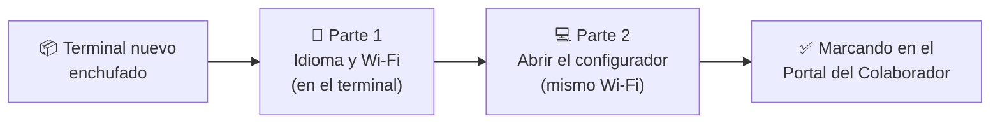
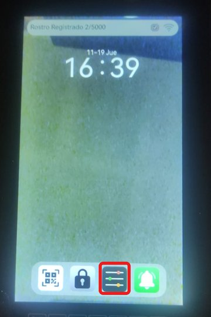
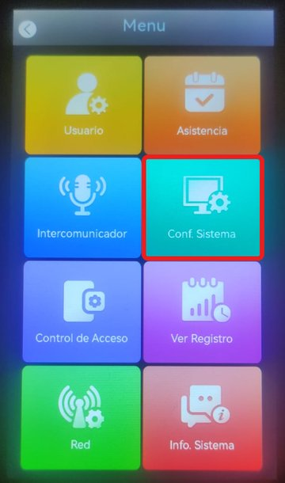
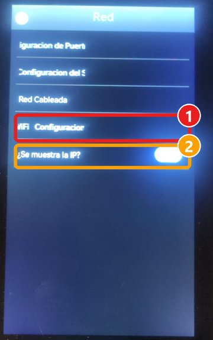
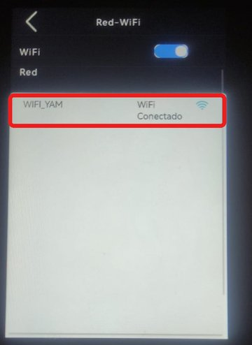
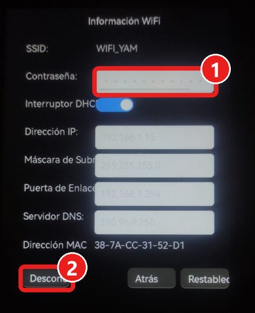
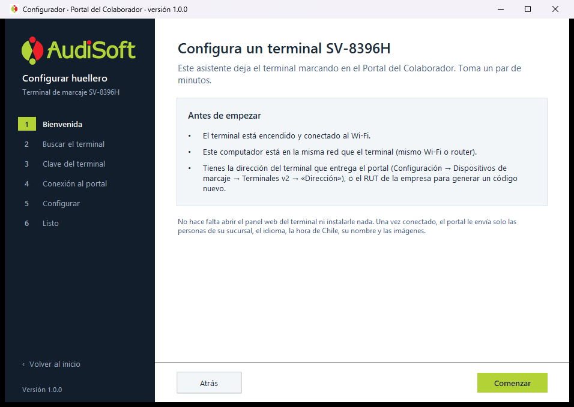
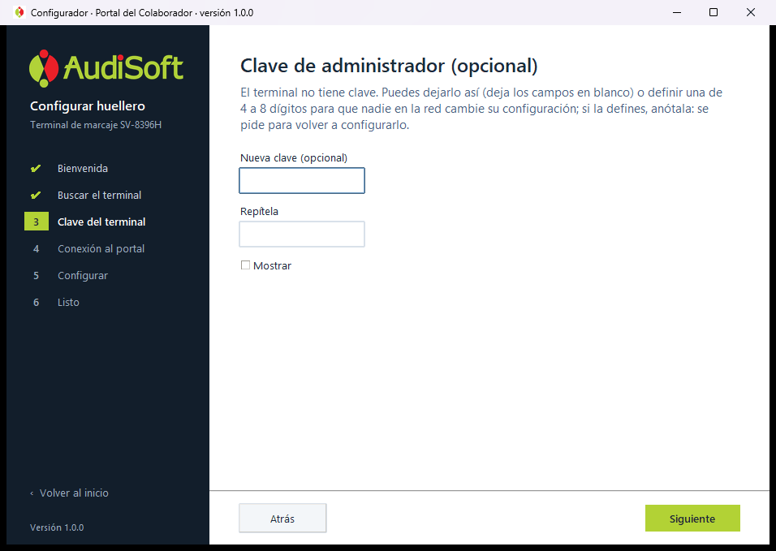
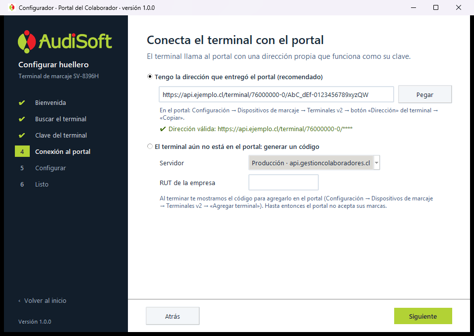
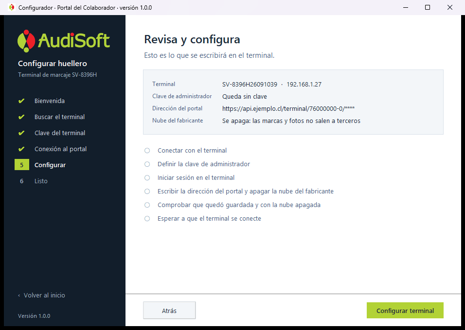

# Configurador de equipos de marcaje

Programa de Audisoft para dejar un **terminal de marcaje SV-8396H** marcando en el
**Portal del Colaborador**. Es un solo `.exe` para Windows: no se instala y se
actualiza solo.

  <a href="https://github.com/AudisoftSPA/audisoft-configurador-autoupdater/releases/latest/download/Configurador-Terminal-SV-8396H.exe"><b>⬇ Descargar el configurador (última versión)</b></a>

---

## Instructivo: terminal recién llegado

Son **dos partes**: primero el terminal se conecta al Wi-Fi (en el propio equipo)
y después el configurador, desde un computador en esa **misma red Wi-Fi**, lo
conecta al portal.

### Antes de empezar

| Qué | Para qué |
|---|---|
| El terminal enchufado a la corriente | Que encienda (tarda cerca de un minuto). |
| Nombre y clave del Wi-Fi donde quedará instalado | El terminal se conecta a esa red. |
| Un computador con Windows **en ese mismo Wi-Fi** | Desde ahí se usa el configurador. |
| La **dirección del terminal** que entrega el portal *(recomendado)* | En el portal: **Configuración → Dispositivos de marcaje → Terminales v2** → botón «Dirección» → «Copiar». Si el terminal aún no está en el portal, basta con el RUT de la empresa (ver paso 2.4). |

> La red tiene que tener **salida a internet**: el terminal habla directo con el portal.

---

### Parte 1 · Idioma y Wi-Fi en el terminal

Se hace tocando la pantalla del terminal. Lo que hay que tocar va marcado en
**rojo**. Si el terminal viene en inglés o chino, guiarse por la **posición y el
color** de cada botón: son los mismos.

#### A. Cambiar el idioma a español

<table>
  <tr>
    <th width="25%">A1 · Abrir el menú</th>
    <th width="25%">A2 · Conf. Sistema</th>
    <th width="25%">A3 · Conf. Dispositivo</th>
    <th width="25%">A4 · Idioma</th>
  </tr>
  <tr align="center" valign="top">
    <td></td>
    <td></td>
    <td></td>
    <td></td>
  </tr>
  <tr valign="top">
    <td>En la pantalla de inicio, tocar el botón de <b>ajustes</b> (las tres barras, el tercero). Un terminal nuevo entra directo, sin clave.</td>
    <td>Tocar <b>Conf. Sistema</b> (turquesa, con un monitor).</td>
    <td>Tocar <b>Conf. Dispositivo</b> (amarillo, con un engranaje).</td>
    <td>Tocar <b>Idioma</b> y elegir <b>Spanish</b>. Volver atrás (<b>‹</b> arriba a la izquierda) hasta el menú.</td>
  </tr>
</table>

#### B. Conectar el Wi-Fi

<table>
  <tr>
    <th width="25%">B1 · Red</th>
    <th width="25%">B2 · WiFi Configuración</th>
    <th width="25%">B3 · Elegir la red</th>
    <th width="25%">B4 · Escribir la clave</th>
  </tr>
  <tr align="center" valign="top">
    <td></td>
    <td></td>
    <td></td>
    <td></td>
  </tr>
  <tr valign="top">
    <td>En el menú, tocar <b>Red</b> (verde, abajo a la izquierda).</td>
    <td><b>①</b> Tocar <b>WiFi Configuración</b>. <b>②</b> <i>(Recomendado)</i> Activar <b>¿Se muestra la IP?</b>: la pantalla de inicio mostrará la IP del terminal, útil si el configurador no lo encuentra solo.</td>
    <td>Con <b>WiFi</b> encendido, tocar la red del lugar.</td>
    <td><b>①</b> Escribir <b>solo la contraseña</b> del Wi-Fi. <b>②</b> Tocar <b>Conectar</b> (botón de la izquierda). Lo demás (DHCP, IP, máscara, puerta de enlace, DNS) <b>no se toca</b>.</td>
  </tr>
</table>

Cuando la red aparece como **«WiFi Conectado»** y el ícono de Wi-Fi se ve
arriba a la derecha en la pantalla de inicio, el terminal ya está listo. Todo lo
demás (dirección del portal, hora de Chile, personas, nombre e imágenes) lo
hacen el configurador y el portal: **no hace falta tocar nada más en el
terminal**.

---

### Parte 2 · Conectarlo al portal con el configurador

**2.0 Abrir el configurador.** Descargar
[`Configurador-Terminal-SV-8396H.exe`](https://github.com/AudisoftSPA/audisoft-configurador-autoupdater/releases/latest/download/Configurador-Terminal-SV-8396H.exe)
y abrirlo con doble clic, en un computador conectado al **mismo Wi-Fi que el
terminal**. Si Windows muestra «Windows protegió su PC», hacer clic en
**Más información → Ejecutar de todas formas** (el programa no va firmado).

<table>
  <tr>
    <td width="50%"></td>
    <td width="50%"></td>
  </tr>
  <tr valign="top">
    <td><b>2.1</b> Elegir <b>Configurar huellero</b>.</td>
    <td><b>2.2</b> La bienvenida resume lo que se va a hacer. <b>Siguiente</b>.</td>
  </tr>
  <tr>
    <td></td>
    <td></td>
  </tr>
  <tr valign="top">
    <td><b>2.3 Buscar el terminal.</b> Aparece como «Terminal de marcaje SV-8396H» con su número de serie (el de la etiqueta de atrás del equipo). Si no aparece, escribir la IP que muestra su pantalla (paso B2 ②) y <b>Probar</b>.</td>
    <td><b>2.4 Clave del terminal.</b> Un terminal nuevo viene sin clave: se puede dejar en blanco o definir una de 4 a 8 dígitos (si se define, <b>anotarla</b>: se pide para volver a configurarlo).</td>
  </tr>
  <tr>
    <td></td>
    <td></td>
  </tr>
  <tr valign="top">
    <td><b>2.5 Conexión al portal.</b> Pegar la <b>dirección</b> copiada del portal (recomendado). Si el terminal aún no está en el portal, elegir «generar un código», el servidor y el RUT de la empresa.</td>
    <td><b>2.6 Revisar y configurar.</b> Muestra lo que se escribirá en el terminal. <b>Configurar terminal</b> y esperar los ✔.</td>
  </tr>
  <tr>
    <td></td>
    <td valign="top">
      <b>2.7 ¡Terminal conectado!</b>  
      En menos de un minuto el terminal recibe las personas de su sucursal, el
      idioma, la hora de Chile, su nombre y las imágenes de Audisoft.  
      <b>Si se usó «generar un código»:</b> falta un paso. En el portal,
      <b>Configuración → Dispositivos de marcaje → Terminales v2 → «Agregar terminal»</b>,
      pegar el código, ponerle nombre y elegir la sucursal. Guardar bien el código:
      funciona como clave del terminal y el configurador no lo vuelve a mostrar.
    </td>
  </tr>
</table>

**Último paso:** enrolar a cada persona en el propio terminal
(menú → **Usuario**): rostro, huella o tarjeta.

---

### Si algo no funciona

| Problema | Qué hacer |
|---|---|
| El configurador no encuentra el terminal | Revisar que el computador y el terminal estén en el **mismo Wi-Fi** (no en la red de invitados). Escribir la IP que muestra la pantalla del terminal (paso B2 ②) y **Probar**. |
| Pide una clave que nadie conoce | El terminal ya fue configurado antes con clave. Pedirla a quien lo configuró o a soporte de Audisoft. |
| Termina, pero «el terminal aún no informa conexión» | El Wi-Fi no tiene salida a internet o la bloquea. Probar con otra red. Si se usó un código, primero hay que agregarlo en el portal. |
| El portal no muestra el terminal como conectado | Esperar un minuto (se reporta cada 20 segundos) y revisar en **Configuración → Dispositivos de marcaje → Terminales v2**. |
| Cambió el Wi-Fi del lugar | Repetir solo la **Parte 1 · B** en el terminal. La conexión al portal se mantiene. |

---

## Actualizaciones del configurador

Este repositorio guarda **solo las versiones publicadas del `.exe`**
(pestaña [Releases](https://github.com/AudisoftSPA/audisoft-configurador-autoupdater/releases)).
Al abrirse, el configurador revisa si hay una versión nueva y, en la pantalla de
inicio, ofrece **Actualizar ahora** o **Más tarde**. Sin internet sigue
funcionando igual. La versión en uso se ve abajo a la izquierda y en el título
de la ventana.

El código fuente está en un repositorio privado de Audisoft.
