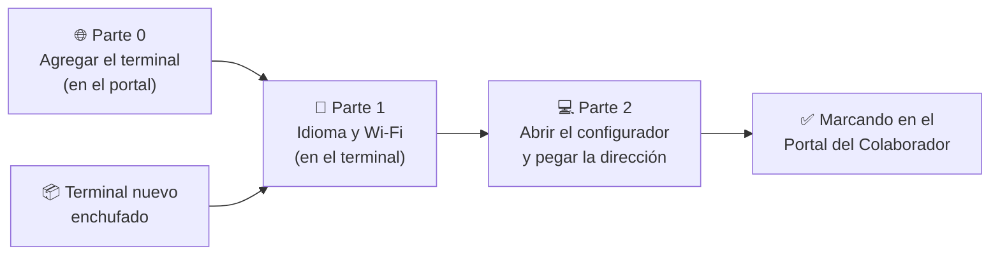
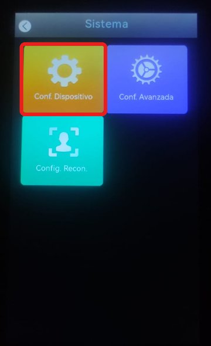
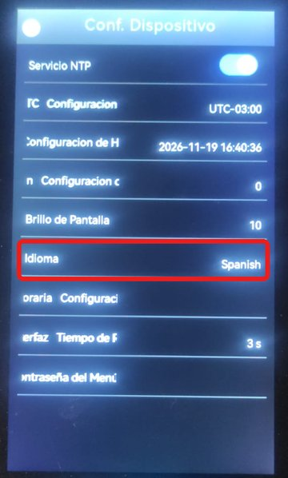
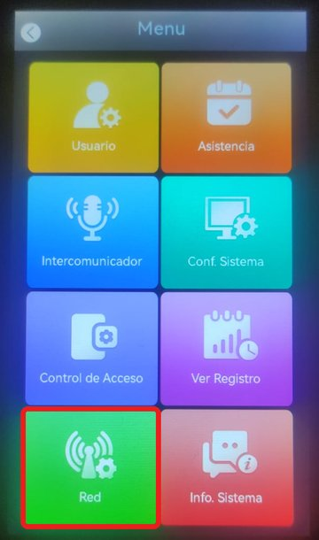
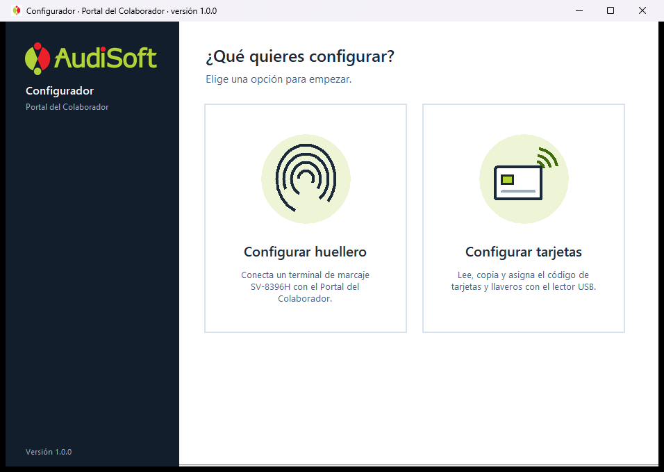
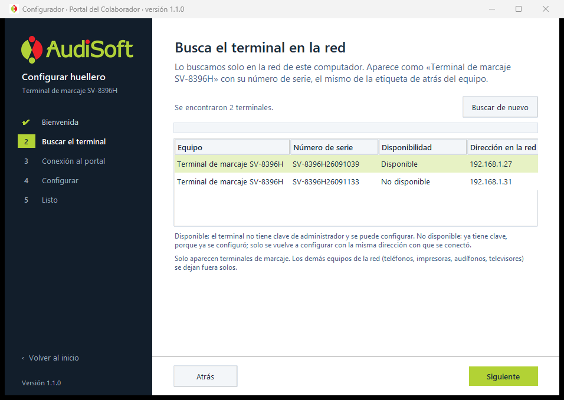
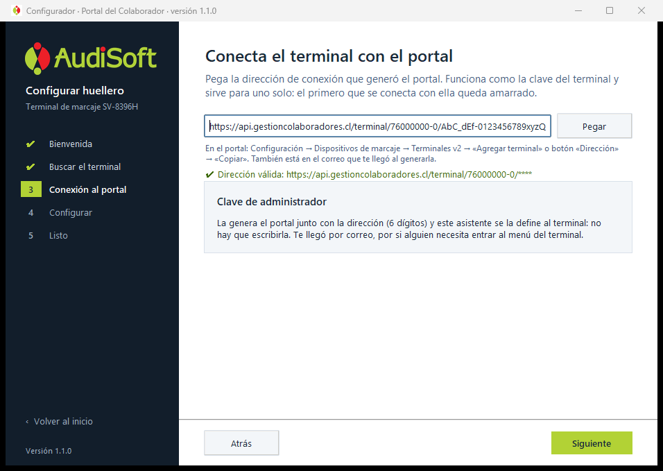
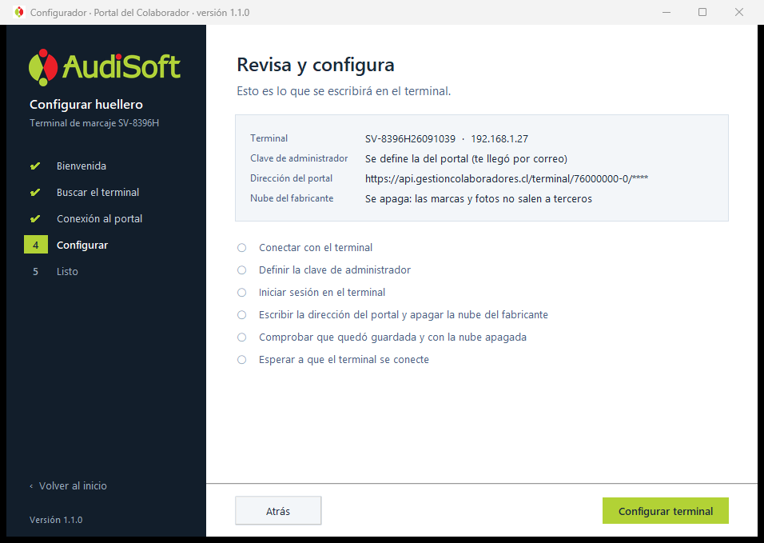
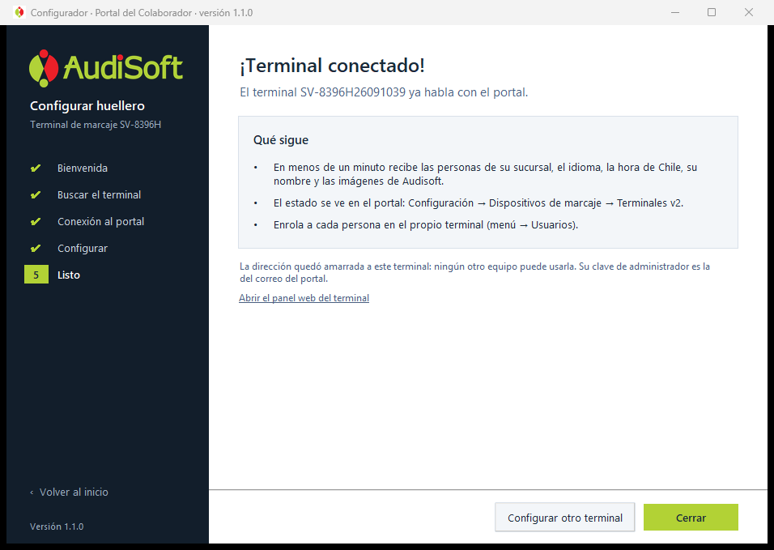

# Configurador de equipos de marcaje

Programa de Audisoft para dejar un **terminal de marcaje SV-8396H** marcando en el
**Portal del Colaborador**. Es un solo `.exe` para Windows: no se instala y se
actualiza solo.

  <a href="https://github.com/AudisoftSPA/audisoft-configurador-autoupdater/releases/latest/download/Configurador-Terminal-SV-8396H.exe"><b>⬇ Descargar el configurador (última versión)</b></a>

---

## Instructivo: terminal recién llegado

Son **tres partes**: en el portal se agrega el terminal (eso entrega su
dirección de conexión), el terminal se conecta al Wi-Fi (en el propio equipo) y
después el configurador, desde un computador en esa **misma red Wi-Fi**, lo
conecta al portal.

### Antes de empezar

| Qué | Para qué |
|---|---|
| El terminal enchufado a la corriente | Que encienda (tarda cerca de un minuto). |
| Nombre y clave del Wi-Fi donde quedará instalado | El terminal se conecta a esa red. |
| Un computador con Windows **en ese mismo Wi-Fi** | Desde ahí se usa el configurador. |
| La **dirección de conexión** del terminal | Se genera en el portal al agregarlo (ver Parte 0) y se copia desde ahí. |

> La red tiene que tener **salida a internet**: el terminal habla directo con el portal.

---

### Parte 0 · Agregar el terminal en el portal

En el portal: **Configuración → Dispositivos de marcaje → Terminales v2 →
«Agregar terminal»**. Ponerle un nombre (se muestra en el equipo) y elegir la
sucursal (el terminal recibe a las personas de esa sucursal).

Al agregarlo, el portal muestra dos cosas. A quien lo agregó le llega **por
correo solo la clave**; la dirección se copia desde el portal (no viaja por
correo):

| Qué | Para qué |
|---|---|
| **Dirección de conexión** (`https://…/terminal/…`) | Copiarla al tiro: se muestra una sola vez. Se pega en el configurador (paso 2.4) y funciona como la clave del terminal. |
| **Clave de administrador del terminal** (6 dígitos, también por correo) | **No hay que escribirla en ninguna parte**: se le carga sola al terminal cuando se conecta. Sirve para entrar al menú del terminal, así que conviene guardarla. |

> **La dirección sirve para un solo terminal.** El primero que se conecta con
> ella queda amarrado y ningún otro equipo la puede usar. Si se pierde o se
> filtró, en el portal se genera otra con el botón **«Dirección»** del terminal
> (la clave de administrador se mantiene).

---

### Parte 1 · Idioma y Wi-Fi en el terminal

Se hace tocando la pantalla del terminal. Lo que hay que tocar va marcado en
**rojo**. Si el terminal viene en inglés o chino, guiarse por la **posición y el
color** de cada botón: son los mismos.

#### A. Cambiar el idioma a español

<table>
  <tr>
    <th width="25%">A1 · Abrir el menú</th>
    <th width="25%">A2 · Conf. Sistema</th>
    <th width="25%">A3 · Conf. Dispositivo</th>
    <th width="25%">A4 · Idioma</th>
  </tr>
  <tr align="center" valign="top">
    <td></td>
    <td></td>
    <td></td>
    <td></td>
  </tr>
  <tr valign="top">
    <td>En la pantalla de inicio, tocar el botón de <b>ajustes</b> (las tres barras, el tercero). Un terminal nuevo entra directo, sin clave.</td>
    <td>Tocar <b>Conf. Sistema</b> (turquesa, con un monitor).</td>
    <td>Tocar <b>Conf. Dispositivo</b> (amarillo, con un engranaje).</td>
    <td>Tocar <b>Idioma</b> y elegir <b>Spanish</b>. Volver atrás (<b>‹</b> arriba a la izquierda) hasta el menú.</td>
  </tr>
</table>

#### B. Conectar el Wi-Fi

<table>
  <tr>
    <th width="25%">B1 · Red</th>
    <th width="25%">B2 · WiFi Configuración</th>
    <th width="25%">B3 · Elegir la red</th>
    <th width="25%">B4 · Escribir la clave</th>
  </tr>
  <tr align="center" valign="top">
    <td></td>
    <td></td>
    <td></td>
    <td></td>
  </tr>
  <tr valign="top">
    <td>En el menú, tocar <b>Red</b> (verde, abajo a la izquierda).</td>
    <td><b>①</b> Tocar <b>WiFi Configuración</b>. <b>②</b> <i>(Recomendado)</i> Activar <b>¿Se muestra la IP?</b>: la pantalla de inicio mostrará la IP del terminal, útil si el configurador no lo encuentra solo.</td>
    <td>Con <b>WiFi</b> encendido, tocar la red del lugar.</td>
    <td><b>①</b> Escribir <b>solo la contraseña</b> del Wi-Fi. <b>②</b> Tocar <b>Conectar</b> (botón de la izquierda). Lo demás (DHCP, IP, máscara, puerta de enlace, DNS) <b>no se toca</b>.</td>
  </tr>
</table>

Cuando la red aparece como **«WiFi Conectado»** y el ícono de Wi-Fi se ve
arriba a la derecha en la pantalla de inicio, el terminal ya está listo. Todo lo
demás (dirección del portal, hora de Chile, personas, nombre e imágenes) lo
hacen el configurador y el portal: **no hace falta tocar nada más en el
terminal**.

---

### Parte 2 · Conectarlo al portal con el configurador

**2.0 Abrir el configurador.** Descargar
[`Configurador-Terminal-SV-8396H.exe`](https://github.com/AudisoftSPA/audisoft-configurador-autoupdater/releases/latest/download/Configurador-Terminal-SV-8396H.exe)
y abrirlo con doble clic, en un computador conectado al **mismo Wi-Fi que el
terminal**. Si Windows muestra «Windows protegió su PC», hacer clic en
**Más información → Ejecutar de todas formas** (el programa no va firmado).

<table>
  <tr>
    <td width="50%"></td>
    <td width="50%"></td>
  </tr>
  <tr valign="top">
    <td><b>2.1</b> Elegir <b>Configurar huellero</b>.</td>
    <td><b>2.2</b> La bienvenida resume lo que se va a hacer. <b>Comenzar</b>.</td>
  </tr>
  <tr>
    <td></td>
    <td></td>
  </tr>
  <tr valign="top">
    <td><b>2.3 Buscar el terminal.</b> Aparece como «Terminal de marcaje SV-8396H» con su número de serie (el de la etiqueta de atrás del equipo) y su <b>disponibilidad</b>: • <b>Disponible</b>: no tiene clave de administrador; es el caso de un terminal nuevo. • <b>No disponible</b>: ya tiene clave, porque ya se configuró. Solo se puede volver a configurar con la misma dirección con que se conectó.</td>
    <td><b>2.4 Conexión al portal.</b> Pegar la <b>dirección de conexión</b> del portal (botón <b>Pegar</b>). El configurador le pide al portal la clave de administrador y se la carga sola al terminal: no se escribe ninguna clave.</td>
  </tr>
  <tr>
    <td></td>
    <td></td>
  </tr>
  <tr valign="top">
    <td><b>2.5 Revisar y configurar.</b> Muestra lo que se escribirá en el terminal. <b>Configurar terminal</b> y esperar los ✔. Al final el terminal <b>se reinicia solo</b> (tarda cerca de un minuto) para tomar la dirección.</td>
    <td><b>2.6 ¡Terminal conectado!</b> En menos de un minuto el terminal recibe las personas de su sucursal, el idioma, la hora de Chile, su nombre y las imágenes de Audisoft. Desde ahí la dirección queda amarrada a ese terminal.</td>
  </tr>
</table>

**Último paso:** enrolar a cada persona en el propio terminal
(menú → **Usuario**): rostro, huella o tarjeta.

---

### Si algo no funciona

| Problema | Qué hacer |
|---|---|
| El configurador no encuentra el terminal | Revisar que el computador y el terminal estén en el **mismo Wi-Fi** (no en la red de invitados) y pulsar **Buscar de nuevo**. La IP que muestra la pantalla del terminal (paso B2 ②) ayuda a confirmar que está en la misma red que el computador. |
| El terminal aparece **No disponible** | Ya tiene clave de administrador: se configuró antes. Si es el mismo terminal, pegar la dirección con que se conectó (o generar una nueva para ese terminal en el portal). Si es un equipo reutilizado de otro lugar, restablecerlo de fábrica desde su menú y buscarlo de nuevo. |
| «Esta dirección ya se usó en otro terminal» | Cada dirección sirve para un solo terminal. Agregar este terminal en el portal (Parte 0) o generar una dirección nueva con el botón **«Dirección»**. |
| «El portal no reconoce esta dirección» | Se generó una dirección más nueva o el terminal se eliminó del portal. Generar una dirección nueva en el portal con el botón **«Dirección»** y copiarla. |
| Termina, pero «el terminal aún no informa conexión» | El Wi-Fi no tiene salida a internet o la bloquea. Probar con otra red. Si se configuró con una versión anterior a la 1.3.0, volver a configurarlo con la versión actual (pega la misma dirección): la 1.3.0 lo reinicia y lo deja conectado. |
| El portal no muestra el terminal como conectado | Esperar un minuto (se reporta cada 20 segundos) y revisar en **Configuración → Dispositivos de marcaje → Terminales v2**. |
| Cambió el Wi-Fi del lugar | Repetir solo la **Parte 1 · B** en el terminal. La conexión al portal se mantiene. |

> **Desde la versión 1.1.0** el configurador ya no pide escribir la IP a mano,
> ni la clave del terminal, ni genera códigos con el RUT de la empresa: todo
> parte de la dirección de conexión que entrega el portal.

---

## Actualizaciones del configurador

Este repositorio guarda **solo las versiones publicadas del `.exe`**
(pestaña [Releases](https://github.com/AudisoftSPA/audisoft-configurador-autoupdater/releases)).
Al abrirse, el configurador revisa si hay una versión nueva. Desde la 1.2.0 la
**actualización es obligatoria**: muestra **Actualizar ahora** (o **Cerrar el
configurador**) y no se puede usar sin actualizar. Se revisa solo al abrir, así
que nunca interrumpe una configuración en curso. Sin internet sigue funcionando
igual. La versión en uso se ve abajo a la izquierda y en el título
de la ventana.

El código fuente está en un repositorio privado de Audisoft.
